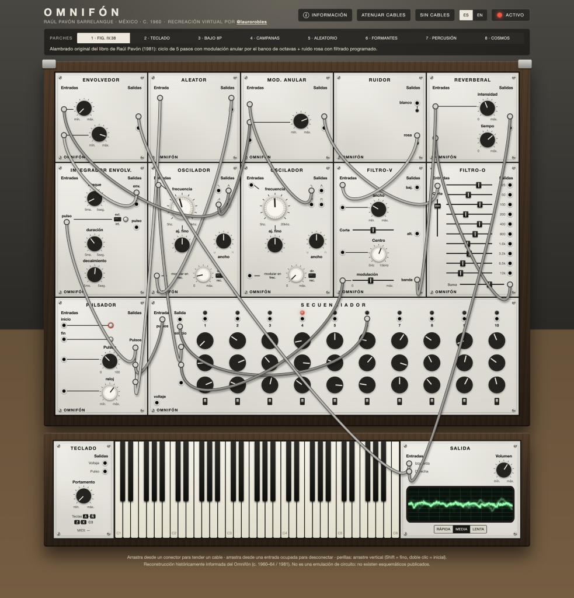

# OMNIFÓN · Sintetizador Modular Virtual

[](https://laurorobles.github.io/Omnifon/)
[](https://github.com/laurorobles/Omnifon/releases)
[](./LICENSE)

**Reconstrucción web modular e interactiva del Omnifón**, reconocido como el **primer sintetizador analógico controlado por voltaje diseñado y construido en México**, obra del ingeniero electricista, pionero del cómputo y compositor **Raúl Pavón Sarrelangue** (c. 1960–1964 / sistematizado en 1981).

Creado por **[@laurorobles](https://www.instagram.com/laurorobles/)** · **[Abrir el instrumento en vivo →](https://laurorobles.github.io/Omnifon/)**

*([Read in English below ↓](#english-overview))*



> [!NOTE]
> **Transparencia histórica:** Debido a que el Omnifón nunca se fabricó comercialmente, no existen esquemáticos electrónicos de circuito ni grabaciones secas certificadas en fuentes abiertas. Este proyecto es una **reconstrucción históricamente informada en DSP** (`Web Audio API` / `AudioWorklet`) basada en las descripciones técnicas, diagramas de paneles y láminas publicadas por el propio Raúl Pavón en *La electrónica en la música… y en el arte* (SEP / INBA-CENIDIM, 1981). Consulta el detalle completo en **[`docs/INVESTIGACION.md`](./docs/INVESTIGACION.md)**.

---

## Características principales

- **14 módulos DSP independientes a frecuencia de audio:** Cada panel del gabinete corre en su propio `AudioWorkletProcessor`, permitiendo modulación real muestra por muestra (FM, modulación anular, filtrado controlado por voltaje y secuencias analógicas).
- **Parcheo con cables virtuales en tiempo real:** Conecta y desconecta cualquier salida con cualquier entrada arrastrando con el ratón o pantalla táctil, con modo **Atenuar cables** para operar cómodamente los controles.
- **Banco de 8 parches musicales y experimentales (con *Figura IV.38* siempre al inicio):** Explora desde el alambrado original publicado por Raúl Pavón en su libro de 1981 hasta solistas de teclado, bajos secuenciados, metalofonía anular, máquinas aleatorias autocicladas, coros formánticos, percusión polimétrica y drones cósmicos (más botón **Sin cables** para parchar desde cero).
- **Interfaz bilingüe (`ES` / `EN`):** Español por defecto con traducción instantánea al inglés de todos los paneles, controles, presets y documentación histórica integrada.
- **Teclado de 5 octavas + soporte Web MIDI:** Toca con el ratón (con glissando), el teclado de tu computadora (`A`–`Ñ`, `Z`/`X` para octavas) o cualquier controlador MIDI USB.

---

## Módulos del gabinete

| Ubicación | Módulo | Descripción |
|---|---|---|
| **Fila 1** | **Envolvedor** | Amplificador controlado por voltaje (VCA) con 2 entradas atenuables (`mín.–máx.`) y doble salida en paralelo |
| **Fila 1** | **Aleator** | Generador aleatorio calibrado (sin perillas, fiel al original) con entrada de pulso y doble salida (`Escalón` / `Suave`) |
| **Fila 1** | **Mod. Anular** | Modulador en anillo con 3 entradas, control central `mín.–máx.` y doble salida en paralelo |
| **Fila 1** | **Ruidor** | Fuentes calibradas de ruido `blanco` y `rosa` (`−3 dB/oct`) |
| **Fila 1** | **Reverberal** | Reverberador de estudio con 2 entradas, controles `Intensid.` y `tiempo` y doble salida |
| **Fila 2** | **Integrador Envolv.** | Envolvente trapezoidal de 3 etapas (`ataque`, `duración`, `decaimiento`), selector `ext./int.`, disparo manual y salidas `env.`/`pulso` |
| **Fila 2** | **Oscilador 1 y 2** | Dos VCOs continuos (`5hz – 20khz.`) con ondas `∿`, `∧`, `⩘`, `⊓`, ajuste fino, `ancho` y `modular en frec.` |
| **Fila 2** | **Filtro-V** | Filtro controlado por voltaje con perillas `ancho` y `Centro` (`5Hz–15kHz`), deslizadores `Corte` y `modulación`, y salidas `baj.`, `alt.`, `banda` |
| **Fila 2** | **Filtro-O** | Banco gráfico de 10 bandas (`25 Hz – 13 kHz`) con deslizador vertical `Corte`, deslizador `Suma` y 11 salidas individuales |
| **Fila 3** | **Pulsador** | Reloj maestro con disparadores `inicio` y `fin`, controles `Pulsos` (`0–100`) y `reloj`, y bus de 3 salidas |
| **Fila 3** | **Secuenciador** | Matriz `3 × 10` con salidas por fila a la izquierda, 10 conectores superiores de paso (puenteables a `reinicio`) y 10 interruptores inferiores |
| **Consola** | **Teclado + Salida** | Teclado de 61 teclas (`Voltaje` + `Pulso`, portamento, MIDI) y etapa estéreo con osciloscopio de fósforo verde |

---

## Banco de 8 parches incluidos

| # | Parche | Enfoque musical / experimental |
|---|---|---|
| **1** | **`1 · Fig. IV.38`** *(Por defecto)* | Recreación documental del alambrado del libro de Raúl Pavón (1981): ciclo de 5 pasos con modulación anular por el banco de octavas + ruido rosa con filtrado programado. |
| **2** | **`2 · Teclado`** | Voz solista sustractiva expresiva (1960–64) con vibrato sutil y filtro resonante para tocar en el teclado de 5 octavas o vía MIDI. |
| **3** | **`3 · Bajo 8p`** | Secuencia rítmica de bajo analógico en 8 pasos (puente al paso 9) con pulso variable y resonancia modulada por paso. |
| **4** | **`4 · Campanas`** | Metalofonía electroacústica estilo estudio de Colonia: modulación anular inarmónica en compás asimétrico de 7 pasos esculpida por el `Filtro-O`. |
| **5** | **`5 · Aleatorio`** | Estudio generativo autónomo: el `Integrador` autocicla en modo interno (`int.`) disparando al `Aleator` para generar gestos melódicos y FM impredecibles. |
| **6** | **`6 · Formantes`** | Coro espectral: rampa armónica y aliento de ruido rosa esculpidos como formantes vocales en el `Filtro-O` (también responde al teclado). |
| **7** | **`7 · Percusión`** | Laboratorio polirrítmico de 10 pasos con bombos de barrido exponencial y ráfagas metálicas de ruido blanco gobernadas por los switches inferiores. |
| **8** | **`8 · Cosmos`** | Paisaje contemplativo de oleadas lentas autocicladas, modulación anular subaudible y viento estelar sobre el banco de octavas. |

---

## Documentación del proyecto

| Documento | Contenido |
|---|---|
| **[Manual de Usuario Ilustrado (`docs/MANUAL.md`)](./docs/MANUAL.md)** | Guía paso a paso ilustrada con fotografías del aparato original, referencia de los 14 módulos, gestos, atajos de teclado, Web MIDI y tutorial de los 8 presets. |
| **[Plan de Trabajo y Hoja de Ruta VST (`docs/ROADMAP_VST.md`)](./docs/ROADMAP_VST.md)** | Plan de desarrollo para portar el motor DSP a formatos nativos de plugin VST3 / AU / CLAP con JUCE y C++20 para DAWs. |
| **[Investigación Documental Completa (`docs/INVESTIGACION_COMPLETA.md`)](./docs/INVESTIGACION_COMPLETA.md)** | Investigación exhaustiva completa con tablas, gráficos y anexo web interactivo (`public/investigacion.html`). |
| **[Investigación Histórica (`docs/INVESTIGACION.md`)](./docs/INVESTIGACION.md)** | Biografía técnica de Raúl Pavón Sarrelangue, debate de fechamiento (1960 vs. 1964), deslinde del *Icofón*, análisis de la *Figura IV.38*, vacíos documentales y bibliografía académica. |
| **[Arquitectura y DSP (`docs/ARCHITECTURE.md`)](./docs/ARCHITECTURE.md)** | Diagrama del sistema, grafo de `AudioWorkletNodes`, algoritmos DSP módulo por módulo y guía de portabilidad a C++ / JUCE. |
| **[Historial de versiones (`CHANGELOG.md`)](./CHANGELOG.md)** | Registro de cambios por versión. |

---

## Instalación y desarrollo local

Requiere **Node.js 20+**:

```bash
git clone https://github.com/laurorobles/Omnifon.git
cd Omnifon
npm install
npm run dev      # Inicia servidor de desarrollo en http://localhost:5173
npm run build    # Compila TypeScript y genera el paquete estático en dist/
```

---

## English Overview

**Omnifón Virtual** is an interactive, browser-based modular reconstruction of the **Omnifón**—recognized as the **first analog voltage-controlled synthesizer designed and built in Mexico**, created by electrical/computing pioneer and composer **Raúl Pavón Sarrelangue** (c. 1960–1964, expanded and documented in his 1981 CENIDIM book *La electrónica en la música… y en el arte*).

- **Play it live in your browser:** https://laurorobles.github.io/Omnifon/ (click **`EN`** in the top-right bar to switch the entire interface and historical guide to English).
- **Real-time modular audio engine:** 14 independent `AudioWorkletProcessor` modules patched at audio rate with virtual catenary cables, zero runtime dependencies, 5-octave keyboard, and **Web MIDI** support.
- **Default historical patch (`Fig. IV.38`):** Recreates the original wiring example published in Pavón’s 1981 book, pairing a 5-step ring-modulated melodic sequence routed through the 10-band octave filter bank with a second voice of sequencer-modulated bandpass pink noise.

---

## Cómo citar / Citation

Si utilizas este instrumento virtual o su documentación en investigación académica, docencia o producción artística, puedes usar el botón **"Cite this repository"** en la barra lateral de GitHub (generado desde [`CITATION.cff`](./CITATION.cff)) o la siguiente referencia:

> Robles, L. (`@laurorobles`). (2026). *Omnifón Virtual: Reconstrucción modular interactiva del primer sintetizador mexicano de Raúl Pavón Sarrelangue* (v1.0.0) [Software]. https://github.com/laurorobles/Omnifon

---

## Créditos y licencia

- **Investigación, diseño e implementación virtual:** Lauro Robles ([@laurorobles](https://www.instagram.com/laurorobles/))
- **Instrumento original y documentación primaria:** Ing. Raúl Pavón Sarrelangue (1927–2008), *La electrónica en la música… y en el arte* (SEP / INBA-CENIDIM, México, 1981).
- **Licencia:** Distribuido bajo la licencia [MIT](./LICENSE).
