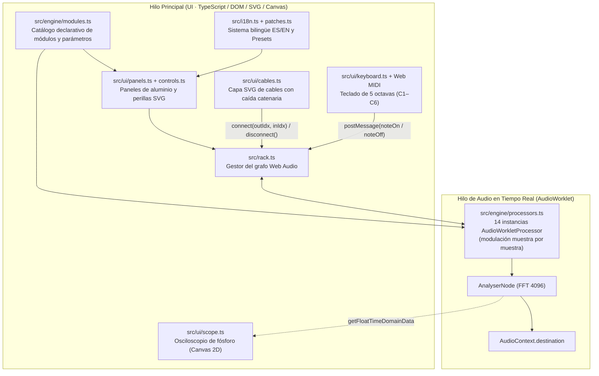

# Arquitectura Técnica y Especificación DSP · Omnifón Virtual

El **Omnifón Virtual** está diseñado sin dependencias externas en tiempo de ejecución (`0 runtime dependencies`), separando estrictamente la especificación declarativa del instrumento, el motor DSP por muestra en el hilo de audio (`AudioWorklet`) y la interfaz física vectorial en el hilo principal.

---

## 1. Diagrama general del sistema



---

## 2. Estructura de directorios

```text
Omnifon/
├── index.html                  # Documento principal + metadatos SEO / Open Graph / JSON-LD
├── package.json                # Scripts y metadatos del paquete (v1.0.0, MIT)
├── vite.config.ts              # Configuración de Vite (bundle de AudioWorklet independiente)
├── CITATION.cff                # Metadatos académicos de citación para GitHub
├── public/
│   ├── fig-iv-38.jpg           # Lámina histórica original (Raúl Pavón, CENIDIM 1981)
│   ├── og-preview.png          # Imagen social Open Graph / Twitter Card
│   ├── robots.txt              # Directivas para buscadores
│   └── sitemap.xml             # Mapa del sitio
├── docs/
│   ├── INVESTIGACION.md        # Investigación histórica, organológica y bibliográfica
│   ├── MANUAL.md               # Manual de usuario y recetas de parcheo
│   ├── ARCHITECTURE.md         # Este documento (arquitectura de software y DSP)
│   └── images/
│       └── omnifon-screenshot.png
└── src/
    ├── main.ts                 # Orquestación de estado, persistencia, presets e idioma
    ├── rack.ts                 # Construcción del grafo de AudioWorkletNodes y ruteo dinámico
    ├── patches.ts              # Definición de los 8 parches (encabezados siempre por 1 · Fig. IV.38)
    ├── i18n.ts                 # Traducciones ES/EN y contenido del modal histórico
    ├── style.css               # Diseño físico del gabinete, aluminio, perillas SVG y cables
    ├── engine/
    │   ├── modules.ts          # Fuente única de verdad: puertos E/S, rangos, curvas y layout
    │   └── processors.ts       # Implementación DSP de los 13 tipos de procesadores
    └── ui/
        ├── panels.ts           # Generador de paneles modulares a partir de modules.ts
        ├── controls.ts         # Perillas vectoriales estriadas SVG, faders y conmutadores
        ├── cables.ts           # Parcheo interactivo con curvas Bézier catenarias
        ├── keyboard.ts         # Teclado de 61 teclas (puntero con glissando + QWERTY)
        └── scope.ts            # Osciloscopio con disparo por cruce ascendente por cero
```

---

## 3. Grafo modular en `AudioWorklet`

A diferencia de los sintetizadores web basados en un único procesador monolítico o en nodos nativos limitados, el Omnifón instancia **14 nodos `AudioWorkletNode` independientes** (uno por panel físico del gabinete), configurados en modo discreto monocanal (`channelCount: 1`, `channelInterpretation: 'discrete'`) salvo el módulo maestro `Salida` (`outputChannelCount: [2]`).

- **Parcheo nativo sin latencia de interfaz:** Tender un cable entre `moduloA.salidaX` y `moduloB.entradaY` invoca directamente `nodeA.connect(nodeB, outIndex, inIndex)` en el motor C++ subyacente del navegador.
- **Audio y CV unificados:** Todas las señales (audio, voltajes `1.0 = 1 oct`, pulsos `0/1`) viajan como flujos `Float32Array` de 128 muestras a la frecuencia de muestreo nativa (`44.1` / `48` / `96 kHz`), permitiendo modulación en frecuencia de audio (FM, modulación anular, disparo rápido de envolventes y barridos de filtro).
- **Suavizado anti-zipper:** La clase base `Mod` interpola linealmente los cambios de `AudioParam` (`k-rate`) a lo largo de cada bloque de 128 muestras mediante `ramp()`, eliminando chasquidos al girar perillas sin desperdiciar memoria dinámica en el hilo de tiempo real (buffers preasignados, cero presión al recolector de basura).

---

## 4. Especificación DSP por módulo

| Módulo | Algoritmo / Topología DSP | Notas de implementación |
|---|---|---|
| **`Oscilador`** | Acumulador de fase `[0, 1)` + **PolyBLEP** de 2 muestras en discontinuidades | Senoidal pura (`Math.sin`), triangular analítica y rampa/pulso variable con corrección polinómica anti-aliasing; barrido continuo `5 Hz – 20 kHz` limitado a `0.45 × sampleRate`. |
| **`Filtro-V`** | **ZDF-SVF** (filtro de variables de estado sin retardo en el lazo de realimentación, topología trapezoidal de Andrew Simper) | Estable ante modulación rápida a frecuencia de audio y resonancia extrema; entrega simultáneamente salidas `low`, `band` y `high`, con saturación racional suave a la entrada. |
| **`Filtro-O`** | Banco paralelo de **10 filtros ZDF-SVF pasa-banda** (`Q ≈ 1.41`, ancho de 1 octava) | Bandas fijas en `25, 50, 100, 200, 400, 800, 1600, 3200, 6500, 15000 Hz`; expone las 10 salidas individuales más la mezcla ponderada `Suma`. |
| **`Ruidor`** | Generador pseudoaleatorio **`xoshiro128**`** + filtro rosa de **Paul Kellet** (6 polos/ceros en `Float64`) | Espectro blanco plano libre de patrones periódicos audibles y aproximación `−3 dB/oct` con precisión `±0.05 dB`. |
| **`Mod. Anular`** | Multiplicador de cuatro cuadrantes (`a × b`) | Si la entrada `B` no está conectada, conmuta automáticamente a su oscilador senoidal interno (`Portadora`). |
| **`Envolvedor`** | Amplificador lineal acotado `[0, 2]` | Ganancia `clamp(min + max × control, 0, 2)` con dos salidas idénticas en paralelo. |
| **`Integrador Envolv.`** | Máquina de estados **ADSR exponencial (curvas RC)** | Constantes calibradas a umbrales reales (`−60 dB` en extinción); redisparo continuo desde el nivel instantáneo actual (cero clics) y salidas directa (`+env`) e inversa (`−env`). |
| **`Aleator`** | Muestreo y retención (*Sample & Hold*) sobre `xoshiro128**` + filtro de un polo | Reloj interno autónomo que cede automáticamente el control al detectar cable en `Entrada`; salidas simultáneas `Escalón` y `Suave`. |
| **`Reverberal`** | Red **Schroeder / Freeverb** escalada a `sampleRate` | Mezclador previo de 2 entradas → 8 filtros peine (*comb*) con amortiguamiento de agudos en paralelo → 4 filtros pasa-todo (*all-pass*) en serie. |
| **`Pulsador`** | Oscilador de reloj rectangular con detección de flanco (`Trigger`) | Entradas de arranque/paro externo, botón de marcha sincronizado con LED en UI y salidas dobles en fase más salida invertida. |
| **`Secuenciador`** | Contador síncrono de `1..10` pasos con matriz `3 × 10` | Cuantizador cromático opcional en `Fila A` (`round(v × 24) / 12` para cubrir 2 octavas exactas por semitonos); notifica el paso activo a los LEDs vía `MessagePort`. |
| **`Teclado`** | Pila de notas activas con **prioridad a la última nota** | Portamento exponencial y brecha de redisparo de `64 muestras` (~1.3 ms a 48 kHz) al articular notas ligadas para disparar limpiamente el `Integrador` o el `Secuenciador`. |
| **`Salida`** | Etapa maestra estéreo con mezcla cruzada suave y saturación racional | Si ambas entradas están conectadas, aplica apertura estéreo natural (`85 % / 25 %`) para evitar fatiga en audífonos; protección final mediante aproximación racional de `tanh(x)`. |

---

## 5. Ruta de migración a plugin nativo VST3 / AU / CLAP

El motor fue escrito pensando desde el día uno en su futura compilación nativa en **C++20 (JUCE)** o **Rust (`nih-plug`)**:

1. `src/engine/modules.ts` mapea 1:1 a un `juce::AudioProcessorValueTreeState` (mismos IDs, rangos, valores por defecto y curvas logarítmicas).
2. Todas las clases DSP en `src/engine/processors.ts` (`Oscilador`, `FiltroV`, `FiltroO`, `Svf`, `Rng`, `Comb`, `Allpass`, etc.) utilizan aritmética escalar pura sobre arreglos contiguos sin llamadas a APIs del navegador ni asignaciones dinámicas en `process()`, por lo que pueden trasladarse directamente a clases C++ dentro de un `juce::AudioProcessorGraph`.
