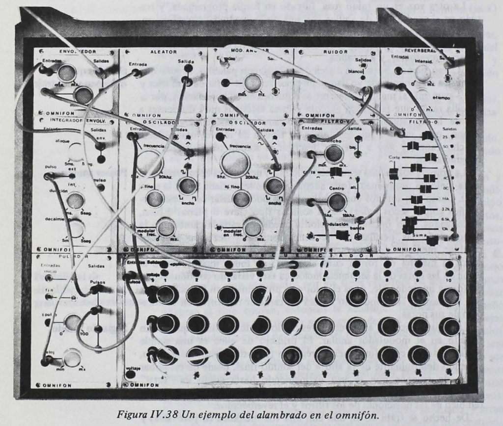

# Investigación histórica y organológica: El Omnifón de Raúl Pavón Sarrelangue

> **Nota metodológica:** El presente documento sintetiza la evidencia histórica, bibliográfica e iconográfica disponible sobre el **Omnifón**, estableciendo con rigor qué aspectos están documentados en fuentes primarias y secundarias, y qué vacíos técnicos suplimos mediante criterios de ingeniería DSP en su reconstrucción virtual.

---

## 1. Raúl Pavón Sarrelangue y los orígenes de la luthería electrónica en México

**Raúl Pavón Sarrelangue** (México, c. 1927/1928–2008) reunió un perfil excepcional en América Latina a mediados del siglo XX: ingeniero electricista y pionero de la computación (trabajó en la *Mexican Light and Power Company* y en la Comisión Federal de Electricidad, presentando en **1958** la primera ponencia mexicana sobre cómputo electrónico en un congreso nacional en Estados Unidos), guitarrista formado con Andrés Segovia y compositor e investigador formado en los estudios de música electroacústica de **Milán** y **Colonia**.

### El precursor magnético de 1958
Tras asistir en **1958** a un concierto de *música concreta* en la Radio Francesa en París, Pavón concibió y construyó un primer instrumento experimental: un teclado de una octava en el que cada tecla accionaba un bucle independiente de cinta magnética pregrabada (principio análogo al *Multiórgano* desarrollado en Cuba por Juan Blanco y a los precursores del *Chamberlin* / *Mellotron*). Al intentar registrar la patente, descubrió que el principio ya había sido patentado internacionalmente, lo que lo impulsó a diseñar un generador electrónico puro controlado por voltaje.

---

## 2. El Omnifón: fechamiento, desarrollo paralelo e impacto institucional

El **Omnifón** (del latín *omnis* y el griego *phōnē*: «todos los sonidos») es reconocido unánimemente en la historiografía musical como el **primer sintetizador analógico diseñado y construido en México**, y uno de los primeros instrumentos controlados por voltaje gestados de manera independiente en el mundo, en paralelo a los desarrollos de:

- **Robert Moog** y **Donald Buchla** (Estados Unidos, 1963–1965)
- **Paolo Ketoff** y **John Eaton** (*Synket*, Roma, 1964)
- **Erkki Kurenniemi** (*Integrated Synthesizer*, Helsinki, 1964–1968)
- **Harald Bode** (Alemania / EE. UU., 1960–1961)

### El debate sobre su fechamiento (1960 vs. ~1964)
En la literatura especializada coexisten dos fechas principales para el primer prototipo físico:
1. **1960:** Fecha consignada por el propio Raúl Pavón en su libro de 1981 y retomada por investigadores como **Ricardo Dal Farra** (2006), **Manuel Rocha Iturbide** y Martín Matus Lerner (2019).
2. **c. 1964:** Fecha propuesta por el musicólogo **Gabriel Pareyón** en el *Diccionario Enciclopédico de Música en México* (Vol. 2, 2007).

En ambos casos, el Omnifón se sitúa en la primera ola mundial de síntesis controlada por voltaje.

### Destino comercial y fundación del Laboratorio del CNM (1970)
Pavón buscó sin éxito que empresas de electrónica establecidas en México fabricaran comercialmente el Omnifón; ante la falta de interés industrial, el instrumento permaneció como prototipo de investigación, creación y demostración didáctica.

En **1965**, Pavón presentó un proyecto formal ante el **Conservatorio Nacional de Música (CNM)** que culminó en **1970** con la inauguración del **primer Laboratorio de Música Electrónica de México**, cofundado junto al compositor **Héctor Quintanar** con el respaldo de **Carlos Chávez**, donde Pavón fungió como director técnico y docente, además de colaborar estrechamente con el **CENIDIM** (Centro Nacional de Investigación, Documentación e Información Musical).

---

## 3. Dos realidades complementarias bajo el nombre «Omnifón»

Al estudiar las fuentes primarias, es indispensable distinguir dos etapas evolutivas documentadas por el propio autor:

1. **El prototipo físico de los años sesenta (c. 1960–1964):**
   - Instrumento sustractivo controlado por voltaje con un oscilador continuo de `10 Hz` a `20 kHz` (~10.97 octavas sin cuantización temperada) capaz de producir ondas **senoidal, cuadrada y rampa** (Pavón subrayaba *«una pureza de onda que no he visto hasta la fecha en ningún sintetizador comercial»*), generador de **ruido blanco**, **filtro controlado por voltaje**, **generador de envolvente** y teclado controlador.
2. **El sistema modular documentado en 1981:**
   - En el **Capítulo IV (págs. 170–204)** de su obra fundamental *La electrónica en la música… y en el arte* (SEP / INBA-CENIDIM, 1981), Pavón sistematizó el Omnifón como un gabinete modular completo orientado a la enseñanza y producción electroacústica, compuesto por módulos de aluminio atornillados en gabinete de madera:
     - **Envolvedor** (amplificador controlado por voltaje / puerta)
     - **Aleator** (generador de voltajes aleatorios)
     - **Modulador Anular** (`MOD. ANULAR`)
     - **Ruidor** (fuentes de ruido blanco y rosa)
     - **Reverberal** (unidad de reverberación con mezcla e intensidad/tiempo)
     - **Integrador de Envolvente** (`INTEGRADOR ENVOLV.`, con disparo externo y pulso manual)
     - **Doble Oscilador** (`5 Hz – 20 kHz`, ajuste fino, ancho de pulso y modulación en frecuencia)
     - **Filtro por Voltaje (`FILTRO-V`)** con salidas de bajos, banda y altos
     - **Banco de Filtros de Octava (`FILTRO-O`)** con 10 bandas deslizantes (`25 Hz` a `15 kHz`) y salida de `Suma`
     - **Pulsador** (reloj maestro de pulsos con inicio/paro)
     - **Secuenciador analógico de 10 pasos y 3 filas de perillas (`3 × 10`)**

### Deslinde de otros desarrollos de Raúl Pavón
No debe confundirse el Omnifón con otros dos desarrollos independientes de Pavón:
- **Filtro polifónico por octavas / tercios de octava controlado por teclado** (adaptación de un banco danés *Brüel & Kjaer*).
- **El Icofón (1976):** Instrumento audiovisual posterior que traducía señales electrónicas en figuras geométricas cromáticas mediante un osciloscopio analógico y discos giratorios de filtros de color (empleado en su *Suite Icofónica*, 1983). Algunos testimonios orales tardíos mezclaron erróneamente la pantalla del *Icofón* con el *Omnifón*.

### Auditoría cronológica de grabaciones (*Fantasía Cósmica*)
No se conocen grabaciones secas certificadas del prototipo original de los años sesenta. Aunque emisiones radiofónicas suelen ilustrar al Omnifón con la célebre obra ***Fantasía Cósmica*** de Raúl Pavón (publicada en el LP *Música Electroacústica Mexicana* de 1984 y remasterizada por la Fonoteca Nacional), dicha pieza fue compuesta entre **1982 y 1984**, cuando Pavón ya disponía del sintetizador modular Moog del CNM y de otros instrumentos comerciales; por rigor histórico, debe tomarse como referencia de su lenguaje estético y espacial, no como muestra acústica directa del hardware de 1960.

---

## 4. Análisis documental de la *Figura IV.38* (1981)

En el cierre del Capítulo IV de *La electrónica en la música… y en el arte* (1981), Pavón incluyó la lámina ***Figura IV.38: Un ejemplo del alambrado en el omnifón*** para ilustrar un parche completo de estudio con dos voces electroacústicas simultáneas:

1. **Sistema de reloj y disparo:** El módulo **Pulsador** envía trenes de pulsos simultáneos al **Secuenciador**, al **Integrador de Envolvente** y al **Aleator**.
2. **Voz 1 — Secuencia melódica y modulación anular:** La primera fila de voltajes del **Secuenciador** gobierna la frecuencia del **Oscilador 1** (con microvariación continua inyectada desde el **Aleator**). Una salida alimenta al **Envolvedor** (articulado por el **Integrador de Envolvente**), mientras otra salida se multiplica con el **Oscilador 2** en el **Modulador Anular (`MOD. ANULAR`)**, esculpiéndose en el banco **Filtro-O** antes de entrar al **Reverberal**.
3. **Voz 2 — Ruido rosa con filtrado programado:** La salida de ruido rosa del **Ruidor** ingresa al **Filtro-V**, cuya frecuencia central es desplazada paso a paso por una segunda fila del **Secuenciador**; su salida pasa-banda se suma en el **Reverberal** hacia la salida maestra.

Este parche histórico constituye el **Preset #1 (`Fig. IV.38`)** cargado por defecto en nuestra reconstrucción virtual.

---

## 5. Vacíos documentales confirmados y decisiones de reconstrucción

| Aspecto técnico | Estado en fuentes públicas | Solución adoptada en el Omnifón Virtual |
|---|---|---|
| **Esquemáticos electrónicos / BOM** | No publicados (prototipo único no comercializado) | Reconstrucción DSP de caja blanca por bloques funcionales a frecuencia de audio |
| **Tecnología activa original (1960–64)** | No especificada (bulbos, transistores discretos o híbrida) | Osciladores de alta pureza espectral (fiel a la cita de Pavón) con saturación suave de protección |
| **Estándar exacto de escala CV** | No especificado (`V/oct` exponencial vs. `Hz/V` lineal) | Escala exponencial interna normalizada (`1.0 = 1 octava`), compatible con teclado cromático y cuantizador |
| **Topología y pendiente exacta del Filtro-V** | Se documentan controles y salidas, no el orden de polos | Filtro de variables de estado sin retardo (ZDF-SVF de Andrew Simper) con salidas simultáneas de bajos, banda y altos |
| ** Curva exacta del Integrador** | Confirmados ataque/decaimiento y disparo externo/manual | Curvas exponenciales tipo RC libres de clics al redisparar |

---

## 6. Fuentes bibliográficas y hemerográficas

1. **Pavón Sarrelangue, Raúl (1981).** *La electrónica en la música… y en el arte*. Ciudad de México: SEP / INBA — CENIDIM, 316 pp. (Especialmente Capítulo IV, págs. 170–204).
2. **Dal Farra, Ricardo (2006).** *A journey of sound through the electroacoustic wires: Art and new technologies in Latin America*. Tesis doctoral, Université du Québec à Montréal (UQAM). [Disponible en Archipel UQAM — D1367.pdf](https://archipel.uqam.ca/2062/1/D1367.pdf) (Figura 23 y sección sobre México).
3. **Pareyón, Gabriel (2007).** *Diccionario Enciclopédico de Música en México*, Vol. 2. Guadalajara: Universidad Panamericana.
4. **Rocha Iturbide, Manuel.** *La música electroacústica en México*. [ArteSonoro.net](https://www.artesonoro.net/electroacustica/electromex.html).
5. **Matus Lerner, Martín (2019).** «Latin American NIMEs: Electronic Musical Instruments and Experimental Sound Devices in the Twentieth Century». *Proceedings of the International Conference on New Interfaces for Musical Expression (NIME 2019)*, Porto Alegre, págs. 228–233. [PDF en NIME.org](https://nime.org/proceedings/2019/nime2019_paper044.pdf).
6. **Sul Ponticello.** «Dispositivos sonoros experimentales y luthería electrónica en América Latina en el siglo XX: antecedentes en Cuba, México y Argentina». [Artículo en línea](https://sulponticello.com/iii-epoca/dispositivos-sonoros-experimentales-y-lutheria-electronica-en-america-latina-en-el-siglo-xx-antecedentes-en-cuba-mexico-y-argentina/).
7. **Fonoteca Nacional de México / Secretaría de Cultura.** Documentación sobre la remasterización del álbum *Música Electroacústica Mexicana* (1984).
