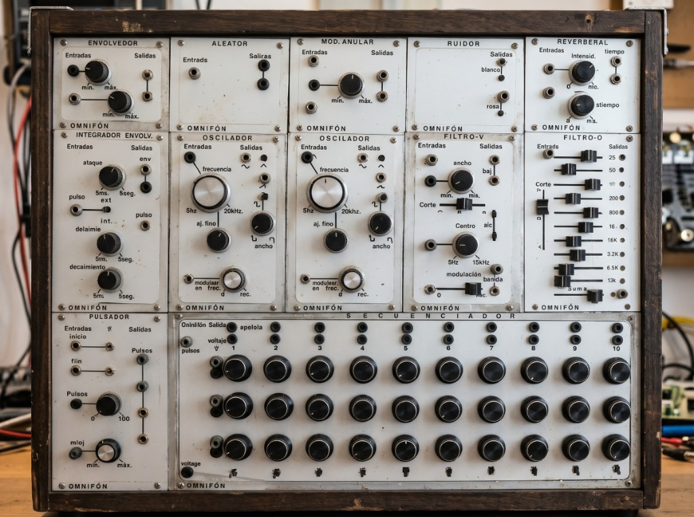
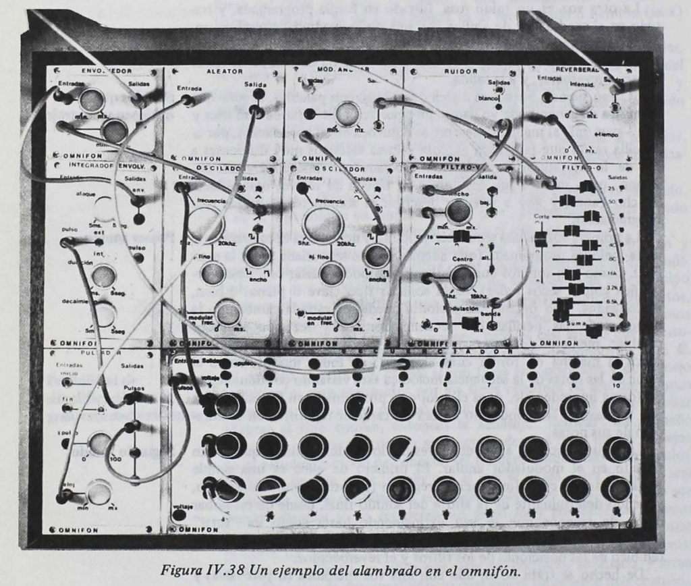

# Manual de Usuario y Guía de Parcheo · Omnifón Virtual

Bienvenido al **Omnifón Virtual**, reconstrucción interactiva en navegador del sintetizador modular mexicano diseñado por el maestro e ingeniero **Raúl Pavón Sarrelangue** (c. 1960–1964 / 1981).


*Figura 1: Vista frontal del gabinete modular analógico del Omnifón original (CENIDIM, México), cuya disposición exacta de 14 módulos, tipografía y controles reproduce este instrumento virtual.*

---

## Índice rápido

1. [Inicio rápido](#1-inicio-rápido)
2. [Gestos de control y alambrado](#2-gestos-de-control-y-alambrado)
3. [Convenciones de señal analógica](#3-convención-de-señales-en-el-gabinete)
4. [Referencia visual módulo por módulo](#4-referencia-módulo-por-módulo)
5. [Banco oficial de 8 parches y recetas](#5-guía-de-los-8-parches-incluidos-y-recetas-propias)
6. [Soporte MIDI y atajos de teclado](#6-soporte-midi-y-atajos-de-teclado)
7. [Transición hacia versión VST / AU / CLAP](#7-transición-hacia-versión-vst--au--clap)

---

## 1. Inicio rápido

1. **Encender el audio:** Haz clic en el botón **`Encender`** (arriba a la derecha). La lámpara roja se iluminará (`Activo`) y comenzará a sonar el parche cargado.
2. **Explorar los 8 parches:** En la barra **`Parches`**, recorre las 8 configuraciones musicales y experimentales encabezadas siempre por **`1 · Fig. IV.38`** (`1 · Fig. IV.38`, `2 · Teclado`, `3 · Bajo 8p`, `4 · Campanas`, `5 · Aleatorio`, `6 · Formantes`, `7 · Percusión` y `8 · Cosmos`). Debajo de la barra verás la explicación de cada parche activo.
3. **Acceder al Manual y GitHub:** En la barra superior cuentas con accesos directos de un clic a este **Manual Ilustrado**, a la ventana de **Información Histórica** y al repositorio abierto en **GitHub**.
4. **Ver debajo de los cables:** Haz clic en **`Atenuar cables`** para volver translúcidos los cables mientras operas controles, o en **`Sin cables`** para desconectar todo y parchar desde cero.
5. **Cambiar idioma:** Usa el conmutador **`ES` | `EN`** en la barra superior para alternar toda la interfaz entre Español e Inglés al instante sin interrumpir el audio.

---

## 2. Gestos de control y alambrado

| Elemento | Acción | Detalle |
|---|---|---|
| **Tender un cable** | Arrastrar desde cualquier conector | Puedes arrastrar de `Salida → Entrada` o de `Entrada → Salida`. Una salida puede alimentar múltiples entradas simultáneamente (distribución tipo *mult* analógico). |
| **Desconectar / mover cable** | Arrastrar desde una **entrada ocupada** | Desenchufa ese extremo: suéltalo fuera para quitarlo o llévalo a otra entrada. |
| **Perillas rotatorias** | Arrastrar verticalmente o rueda del ratón | Mantén **`Shift`** para ajuste fino de alta precisión. **Doble clic** restablece su valor inicial calibrado. |
| **Deslizadores (`Filtro-O`)** | Arrastrar horizontalmente | `Shift` = ajuste fino; doble clic = valor inicial calibrado. |
| **Teclado musical (5 octavas)** | Ratón, pantalla táctil, QWERTY o MIDI | Soporta glissando arrastrando el puntero sobre las teclas. |

---

## 3. Convención de señales en el gabinete

Al igual que en un sintetizador modular analógico de estudio, **todas las señales viajan a frecuencia de audio (sample rate nativo)** dentro de AudioWorklets dedicados:

- **Audio:** Rango nominal `−1.0` a `+1.0`.
- **Voltaje de control (CV):** Escala exponencial donde **`+1.0` equivale a `+1 octava`** (análogo al estándar universal `1 V/oct`).
- **Pulsos y compuertas (Gate/Trigger):** `0.0` (inactivo) a `1.0` (activo), con umbral de disparo analógico en `0.5`.

```
[Secuenciador / Pulsador] ──(Gate / Pulso)──► [Integrador Envolv.]
                                                      │
[Oscilador 1 / 2] ────(Audio)────► [Filtro-V] ────► [Envolvedor VCA] ──► [Salida Estéreo]
                                        ▲                     ▲
                                        │ (CV Envolvente)     │
                                        └─────────────────────┘
```

---

## 4. Referencia módulo por módulo

El gabinete modular reproduce con exactitud la topología documentada por Raúl Pavón en 1981:

### Fila superior (Módulos 1 a 5)

```
┌────────────┬───────────┬─────────────┬───────────┬──────────────┐
│ ENVOLVEDOR │  ALEATOR  │ MOD. ANULAR │  RUIDOR   │  REVERBERAL  │
│   (VCA)    │   (S&H)   │ (Ring Mod)  │  (Noise)  │ (Dual Reverb)│
└────────────┴───────────┴─────────────┴───────────┴──────────────┘
```

1. **`ENVOLVEDOR` (Amplificador controlado por voltaje / VCA)**
   - **Entradas y perillas acopladas (`mín.–máx.`):** `Entrada 1` (nivel base directo de la señal de entrada) y `Entrada 2` (profundidad de ganancia gobernada por la señal de control, típicamente desde el `Integrador Envolv.`).
   - **Salidas:** Par de salidas idénticas en paralelo unidas por barra vertical.

2. **`ALEATOR` (Generador aleatorio de voltajes por pasos y continuos)**
   - **Sin perillas, fiel al módulo original:** Al recibir pulsos en `Entrada`, genera un nuevo voltaje aleatorio en cada flanco ascendente (si `Entrada` está libre, oscila autónomamente a ~2.5 Hz).
   - **Salidas:** Superior (`Escalón`, cambios discretos ideales para melodías aleatorias) e inferior (`Suave`, deriva continua filtrada para vibratos o filtros).

3. **`MOD. ANULAR` (Modulador en anillo analógico de 4 cuadrantes)**
   - **Entradas:** `Entrada 1` (señal de audio A), `Entrada 2` (portadora externa; si está libre, utiliza una portadora senoidal interna pura de `220 Hz`) y `Entrada 3` (modulación de frecuencia o amplitud de la portadora).
   - **Perilla central (`mín.–máx.`):** Nivel de salida del producto anular.
   - **Salidas:** Dos salidas idénticas en paralelo.

4. **`RUIDOR` (Generador de ruido de referencia)**
   - **Sin perillas, fiel al original:** Entrega niveles calibrados de estudio en sus salidas **`blanco`** (espectro plano con igual energía por Hz) y **`rosa`** (`−3 dB/oct`, energía constante por octava, ideal para emulación de viento o percusión acústica).

5. **`REVERBERAL` (Unidad de reverberación con mezclador doble)**
   - **Entradas:** `Entrada 1` y `Entrada 2` (se suman internamente).
   - **Perillas:** `intensidad` (`0–máx.`, proporción de mezcla procesada) y `tiempo` (`0–máx.`, tiempo de caída y dispersión en sala).
   - **Salidas:** Dos salidas en paralelo a la derecha.

---

### Fila media (Módulos 6 a 9)

```
┌────────────────────┬───────────┬───────────┬──────────┬──────────┐
│ INTEGRADOR ENVOLV. │ OSCILADOR │ OSCILADOR │ FILTRO-V │ FILTRO-O │
│  (Trapezoid Env)   │  (VCO 1)  │  (VCO 2)  │  (VCF)   │(10-Band) │
└────────────────────┴───────────┴───────────┴──────────┴──────────┘
```

6. **`INTEGRADOR ENVOLV.` (Envolvente trapezoidal de 3 etapas)**
   - **Controles verticales:** `ataque` (`5ms.–5seg.`), **`duración`** (`5ms.–5seg.`, tiempo de meseta o retención en nivel máximo) y `decaimiento` (`5ms.–5seg.`).
   - **Disparo:** Entrada `pulso` acoplada al conmutador deslizante **`ext.` / `int.`** (`ext.` = disparo por cable de compuerta o con el **pulsador manual** contiguo; `int.` = autociclado continuo tipo LFO trapezoidal periódico).
   - **Salidas:** Par en paralelo `env.` (`0 → +1`) y salida de compuerta `pulso` (activa durante ataque + duración).

7. **`OSCILADOR` (×2 unidades idénticas VCO 1 y VCO 2)**
   - **Frecuencia:** Conector `frecuencia` (`1 oct/unidad`), perilla blanca grande `frecuencia` (`5hz. – 20khz.`) y perilla `aj. fino` (`±2 semitonos`) enlazada verticalmente.
   - **Salidas de onda simultáneas:** `∿` (senoidal pura), `∧` (triangular), `⩘` (rampa / diente de sierra) y `⊓` (pulso rectangular), con perilla inferior derecha `ancho` (`⊔–⊓`, ciclo útil `5–95 %`).
   - **Modulación:** Conector inferior `modular en frec.` enlazado a su perilla blanca (`0–máx.`) y conmutador de acoplamiento **`dir.` / `rec.`** (bipolar directo vs. rectificado positivo de media onda).

8. **`FILTRO-V` (Filtro multimodo controlado por voltaje)**
   - **Sección superior:** Conector de audio `Entrada`, entrada CV + perilla oscura `ancho` (`mín.–máx.`, resonancia / Q / ancho de banda) y deslizador horizontal **`Corte`** (`±2 octavas`).
   - **Sección inferior:** Entrada CV + perilla blanca **`Centro`** (`5Hz – 15kHz`) y entrada CV + deslizador horizontal **`modulación`** (`0 – 5 octavas`).
   - **Salidas simultáneas:** `baj.` (pasa-bajos), `alt.` (pasa-altos) y `banda` (pasa-banda).

9. **`FILTRO-O` (Banco de filtros de 10 octavas fijas)**
   - **Izquierda:** Conector `Entrada` y deslizador vertical **`Corte`** (amortiguamiento progresivo de armónicos agudos).
   - **Centro y derecha:** 10 deslizadores horizontales para **`25`, `50`, `100`, `200`, `400`, `800`, `1.6k`, `3.2k`, `6.5k` y `13k` Hz** con sus 10 salidas individuales independientes, más deslizador y salida maestra **`Suma`**.

---

### Fila inferior y consola (Módulos 10 a 14)

```
┌──────────┬───────────────────────────────────────────────────────┐
│ PULSADOR │               S E C U E N C I A D O R                 │
│ (Clock)  │             (Matriz de 3 × 10 Pasos)                  │
├──────────┴───────────┬───────────────────────────┬───────────────┤
│       TECLADO        │     TECLADO MUSICAL       │    SALIDA     │
│   (Pitch CV/Gate)    │   (5 Octavas C1 - C6)     │ (Scope + Vol) │
└──────────────────────┴───────────────────────────┴───────────────┘
```

10. **`PULSADOR` (Reloj maestro de pulsos analógicos)**
    - **Arranque y paro:** Conectores `inicio` y `fin`, cada uno acoplado a su pulsador metálico redondo para iniciar o pausar la marcha manualmente.
    - **Controles:** Entrada CV + perilla oscura `Pulsos` (`0–100`, ancho porcentual del pulso) y entrada CV + perilla blanca `reloj` (`mín.–máx.`, `0.1 – 40 Hz`).
    - **Salidas:** Bus vertical de 3 salidas (`Pulsos 1` y `2` en fase directa; `Pulsos 3` invertida en antifase).

11. **`S E C U E N C I A D O R` (Matriz analógica de 3 × 10 pasos)**
    - **Columna izquierda:** Entrada `pulsos` (reloj de avance), salida de compuerta `Salida`, entrada `reinicio`, **3 salidas de fila** a la izquierda de cada hilera (Fila 1 cuantizada en semitonos musicales; Filas 2 y 3 continuas) y conector inferior `voltaje` (Fila 1 continua sin cuantizar).
    - **10 columnas (`1–10`):** Cada columna posee arriba su **LED rojo** y su **conector individual de pulso de paso**. Para ciclar un bucle de *N* pasos, conecta con un cable corto la salida del paso *N+1* a la entrada `reinicio` (por ejemplo, en el preset **`Fig. IV.38`**, el paso 6 va a `reinicio` para ciclar exactamente 5 pasos, idéntico a la fotografía histórica).
    - **10 conmutadores inferiores:** Activan o enmudecen la emisión del pulso de compuerta en cada paso individual.

12. **`TECLADO` (Conversor CV/Gate con Glide)**
    - Genera `Voltaje` (1 V/oct) y `Pulso` (Gate) al tocar teclas con ratón, QWERTY o MIDI.
    - Perilla **`Portamento`** (`0 – 0.5 s` de transición suave continua entre notas).

13. **`SALIDA` (Etapa de monitoreo con osciloscopio CRT)**
    - Entradas `Izquierda` y `Derecha` (si sólo se conecta una, se distribuye en mono balanceado).
    - Perilla central de **`Volumen`** con limitador suave libre de saturación digital áspera.
    - **Osciloscopio vectorial:** Selector de base de tiempo (`Rápida`, `Media`, `Lenta`).

---

## 5. Guía de los 8 parches incluidos y recetas propias


*Figura 2: Lámina original IV.38 «Un ejemplo del alambrado en el omnifón» (Raúl Pavón, CENIDIM, 1981).*

### 1 · Fig. IV.38 (Parche histórico de referencia)
- **Topología:**
  - El `Pulsador` marca el compás y avanza el `Secuenciador` en un bucle cerrado de 5 pasos (puente del paso 6 a `reinicio`).
  - La **Voz 1** toma el tono del `Oscilador 1`, lo modula en anillo en el `Mod. Anular` y esculpe sus parciales en el banco de octavas `Filtro-O` antes de enviarlo a la salida izquierda.
  - La **Voz 2** inyecta ruido rosa del `Ruidor` al `Filtro-V`, cuya frecuencia central de corte es gobernada dinámicamente paso a paso por la Fila 2 del secuenciador.

### 2 · Teclado (Sintetizador melódico sustractivo)
- Ideal para interpretación con teclado físico o controlador MIDI.
- El `Oscilador 1` genera una rampa pura gobernada por el `Voltaje` del teclado con portamento. El `Oscilador 2` oscila lentamente a 5.4 Hz actuando como LFO de vibrato sutil.
- La compuerta `Pulso` dispara el `Integrador Envolv.`, que abre el `Filtro-V` y el `Envolvedor` con reverberación cálida.

### 3 · Bajo 8p (Secuencia hipnótica)
- Bucle de 8 pasos (paso 9 conectado a `reinicio`). Onda de pulso cuadrada incisiva con modulación por pasos de la resonancia del filtro.

### 4 · Campanas (Metalofonía electroacústica)
- Secuencia en métrica impar de 7 pasos. Modulación en anillo a frecuencias inarmónicas y filtrado en bandas altas (1.6k, 3.2k, 6.5k Hz) con decaimiento largo en el `Reverberal`.

### 5 · Aleatorio (Generativo autónomo)
- Música autómata sin intervención humana: el `Integrador Envolv.` en modo interno (`int.`) cicla de forma continua y dispara al `Aleator`, produciendo modulaciones armónicas y tímbricas infinitas.

### 6 · Formantes (Coro vocal sintetizado)
- Combina armónicos de rampa y soplo de ruido rosa a través de bandas acentuadas en el `Filtro-O` simulando vocales humanas (A, E, I, O, U). Puede afinarse melódicamente desde el teclado.

### 7 · Percusión (Caja de ritmos analógica)
- Secuencia de 10 pasos que genera golpes secos de bombo mediante caídas exponenciales rápidas y platillos metálicos mediante compuertas sobre ruido blanco.

### 8 · Cosmos (Paisaje drone sci-fi)
- Barridos lentos de frecuencia modulada cruzada (FM), resonancia al borde de la autooscilación y decaimiento espacial profundo.

---

## 6. Soporte MIDI y atajos de teclado

- **Teclado de computadora:**
  - Notas blancas: `A` `S` `D` `F` `G` `H` `J` `K` `L` `Ñ` (o `;` en teclado US).
  - Notas negras: `W` `E` · `T` `Y` `U` · `O` `P`.
  - Cambio de octava: `Z` (bajar) y `X` (subir).
- **Web MIDI:**
  - Compatible de forma nativa con teclados y controladores USB/Bluetooth en navegadores como Google Chrome, Microsoft Edge, Opera y Brave. Al conectar un teclado se reconocerá automáticamente al encender el instrumento.

---

## 7. Transición hacia versión VST / AU / CLAP

Para consultar la arquitectura técnica completa del port nativo para estaciones de trabajo de audio digital (DAWs), consulta el documento oficial:
👉 [**docs/ROADMAP_VST.md**](./ROADMAP_VST.md)
